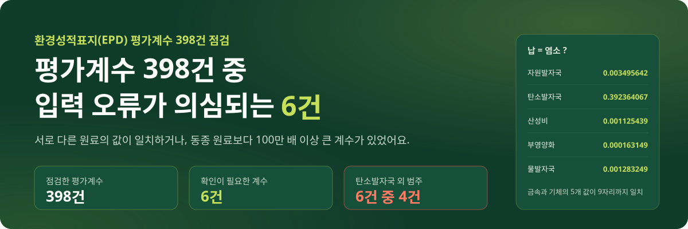
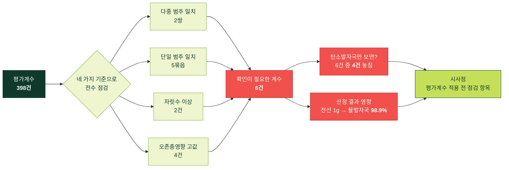
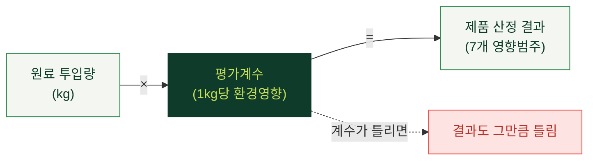
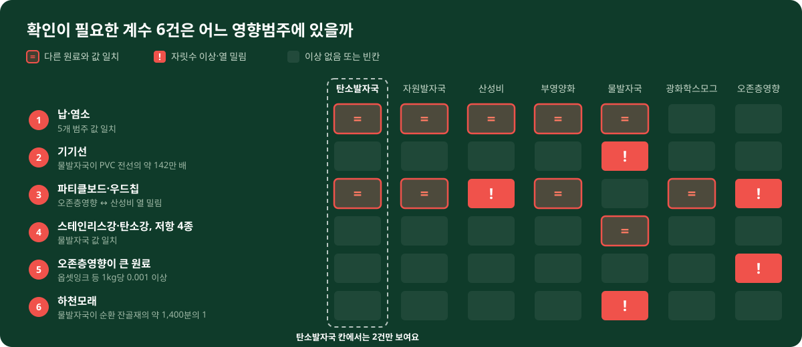
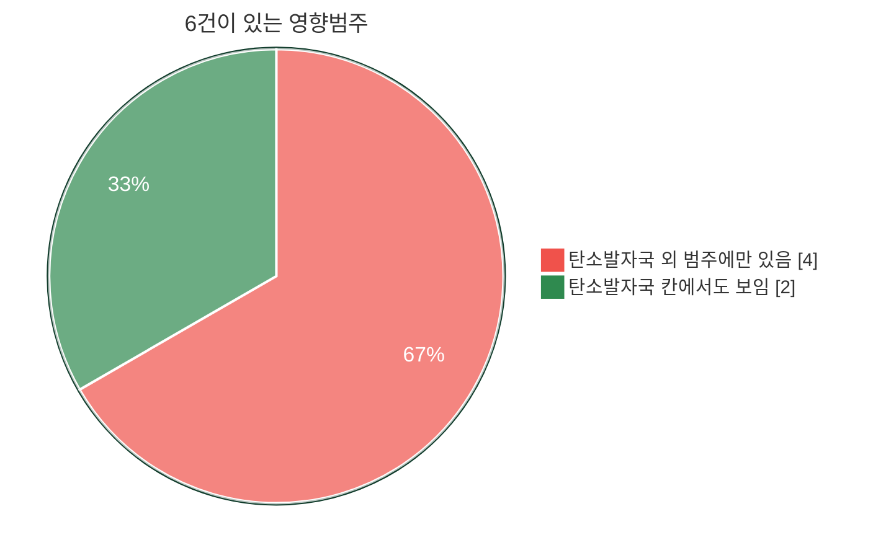
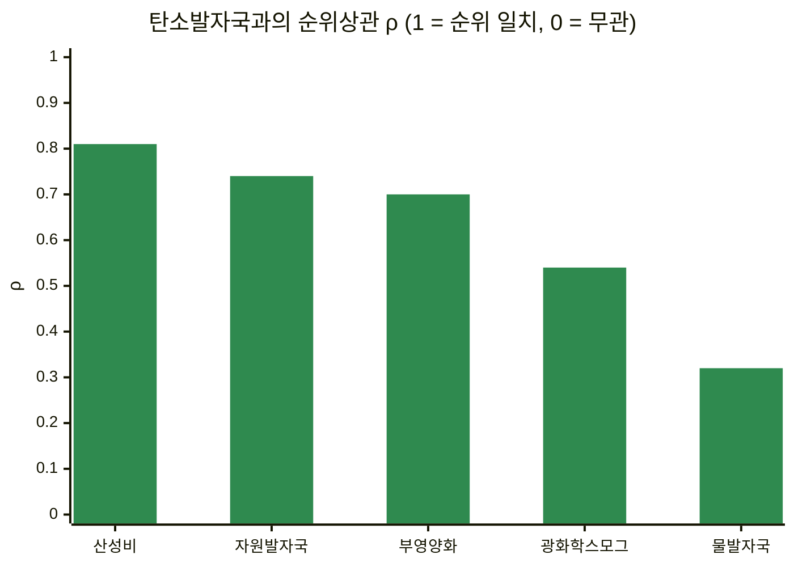
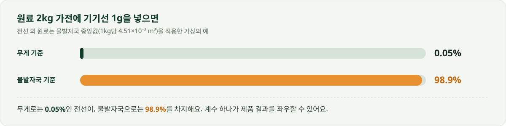
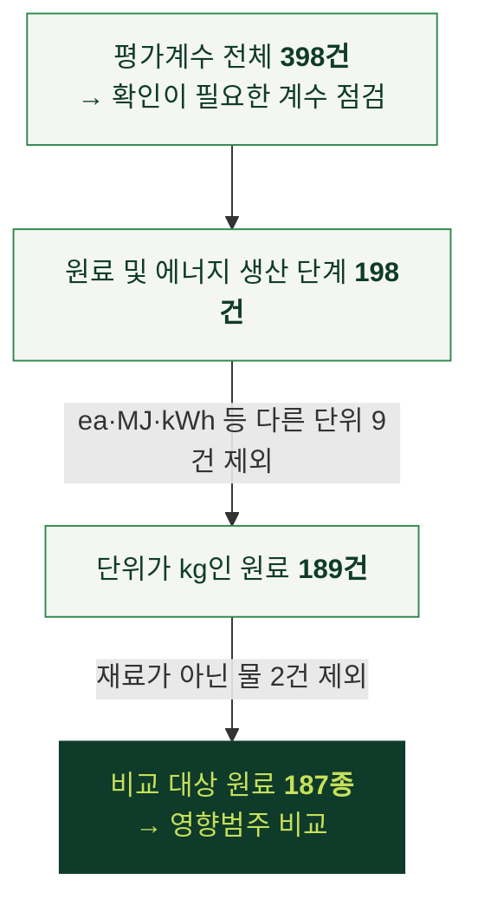
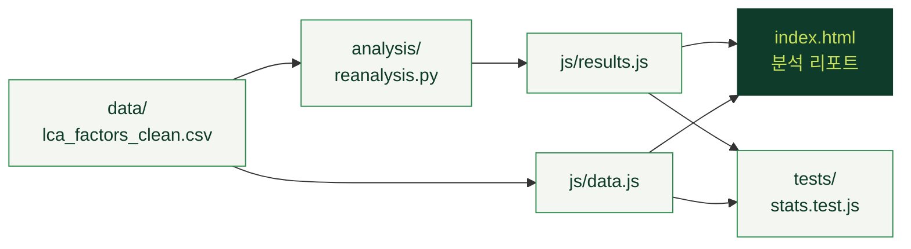

<p align="center">
  
</p>

<p align="center">
  <a href="https://goalbangg-prog.github.io/Beyond-Carbon/"></a>
  
  
  
</p>

# EPD 데이터 분석: 환경성적표지 평가계수 398건 점검

한국환경산업기술원이 공개한 환경성적표지(EPD) 평가계수 398건을 전수 점검해 **입력 오류가 의심되는 계수 6건**을 찾고, 그 계수가 제품 산정 결과를 얼마나 바꿀 수 있는지 계산했습니다.

리포트 상단의 **PDF 저장** 버튼을 누르면 분석 리포트와 방법·출처를 A4 PDF로 저장할 수 있습니다(인쇄 창에서 ‘PDF로 저장’ 선택).

> [!NOTE]
> 배포 파일에 계수별 산정 근거가 없어, 발행 기관 확인 전까지 오류로 단정하지 않았습니다. 제품 산정 예시는 설명을 위한 가상의 예입니다.

## 한눈에 보기



## 왜 평가계수를 점검했나

환경성적표지는 제품 전과정의 환경영향을 7개 범주로 계량해 공개하는 제도입니다. **기준치를 넘어야 받는 인증이 아니라, 산정 결과를 제3자 검증 후 공개하는 제도**입니다. 평가계수는 이 산정에서 원료·에너지 투입량에 곱하는 배경 데이터라서, 계수가 틀리면 산정 결과도 그만큼 틀립니다.



| 영향범주 | 의미 | 단위 |
|---|---|---|
| 탄소발자국 | 온실가스 배출 | kg CO₂ eq |
| 물발자국 | 물 사용 | m³ H₂O eq |
| 자원발자국 | 광물·화석 자원 소모 | kg Sb eq |
| 산성비 | 산성화 물질 배출 | kg SO₂ eq |
| 부영양화 | 수계 영양염 과잉 | kg PO₄³⁻ eq |
| 광화학스모그 | 지표 오존 생성 | kg C₂H₄ eq |
| 오존층영향 | 성층권 오존 파괴 | kg CFC-11 eq |

## 확인이 필요한 계수 6건

입력 오류 가능성과 산정 결과에 미치는 영향이 큰 순서입니다. **1~3번은 입력 실수로 보이고, 4~6번은 그럴 만한 이유가 있을 수도 있습니다.**

<p align="center">
  
</p>

| # | 원료 | 무엇이 이상한가 |
|:-:|---|---|
| 1 | **납 · 염소** | 금속과 기체인데 값이 있는 5개 범주가 유효숫자 아홉 자리까지 같음. 398건 중 유일 |
| 2 | **기기선 UL 1007/1569** | 물발자국 1kg당 812m³, PVC 전선의 약 142만 배. 다른 값은 유효숫자 세 자리인데 이 값만 811.6496189 |
| 3 | **파티클보드 · 우드칩** | 파티클보드의 오존층영향 = 우드칩의 산성비 = 0.000999692. 값이 인접 열로 밀린 흔적 |
| 4 | **스테인리스강 = 탄소강, 저항 4종** | 크롬·니켈 합금과 탄소강, 저항막 재료가 다른 저항 4종의 물발자국이 같음 |
| 5 | **옵셋잉크 등 4종** | 오존층영향 1kg당 0.001 이상. 불소·황 화합물은 공정으로 설명되지만 잉크는 확인 필요 |
| 6 | **하천모래** | 물발자국이 순환 잔골재의 약 1,400분의 1 |

## 탄소발자국만 보면



6건 중 4건은 **탄소발자국이 아닌 범주**에 있습니다. 원료 187종으로 봐도 물발자국은 탄소발자국과 거의 따로 움직였습니다.



| 영향범주 | ρ (95% 범위) | 상위 20% 원료 중 탄소발자국도 상위 20% |
|---|---|---|
| 산성비 | 0.81 (0.72~0.87) | 35종 중 25종 |
| 자원발자국 | 0.74 (0.64~0.81) | 36종 중 22종 |
| 부영양화 | 0.70 (0.57~0.79) | 32종 중 13종 |
| 광화학스모그 | 0.54 (0.39~0.67) | 30종 중 16종 |
| **물발자국** | **0.32 (0.15~0.49)** | **33종 중 14종** |

기초화학물질을 빼도(ρ 0.32), 확인이 필요한 계수를 빼도(0.28, 0.23) 물발자국의 결론은 같았습니다.

## 산정 결과에 미치는 영향

<p align="center">
  
</p>

| 가상의 예 | 결과 |
|---|---|
| 원료 2kg 가전에 기기선 투입 | 전선 1g(무게의 0.05%)이 제품 물발자국의 **98.9%**를 차지. 리포트에서 1~100g으로 바꿔 볼 수 있음 |
| 콘크리트 잔골재 800kg | 순환 잔골재 162L vs 하천모래 0.12L. 재활용 원료가 **약 1,400배** 불리하게 계산됨 |

### 시사점: 평가계수 적용 전 확인할 것

| | 항목 | 확인할 내용 |
|:-:|---|---|
| ① | 기준 단위 | 1kg당인지, 1ea·1MJ·1m³당인지 (같은 단계 안에서도 섞여 있음) |
| ② | 값 일치 | 다른 원료와 값이 같다면 대체 데이터인지 확인하고 출처 기록 |
| ③ | 자릿수 | 동종 원료와 수천 배 이상 차이 나면 산정 근거 확인 |
| ④ | 기여도 쏠림 | 결과 대부분이 한 원료에서 나오면 그 계수부터 재검토 |
| ⑤ | 전 범주 검토 | 탄소발자국만이 아니라 7개 범주 모두 같은 기준으로 점검 |
| ⑥ | 빈칸 | ‘해당없음’을 0으로 처리하지 않고 별도 자료로 보완 |

## 결과 확인과 한계

| 주장 | 근거 | 신뢰 수준 |
|---|---|:-:|
| 입력 오류가 의심되는 계수가 있다 | 네 가지 기준을 398건 전체에 동일하게 적용, 공개 자료 값 그대로 재현 가능 | 🟢 높음 |
| 탄소발자국만 검토하면 이상값을 놓친다 | 6건 중 4건이 탄소 외 범주, 부트스트랩 2,000회·재료 종류 제외·6건 제외에도 결론 동일 | 🟢 높음 |
| 그대로 쓰면 산정 결과가 크게 바뀔 수 있다 | 가상 제품 계산 (투입량은 가정) | 🟡 중간 |

<details>
<summary><b>이 분석으로 말할 수 없는 것</b> (펼치기)</summary>

| 말할 수 없는 것 | 이유 | 확인하려면 |
|---|---|---|
| 6건이 실제 오류인지 | 배포 파일에 산정 근거가 없음 | 발행 기관에 산정 근거 문의 |
| 실제 제품의 결과 변화 | 산정 예시의 투입량은 가정 | 실제 제품 BOM으로 재계산 |
| 제품 단위의 탄소–물 관계 | 전기·연료 같은 공통 투입이 있음 | 동일 기능 제품들의 EPD 결과 비교 |
| 원료 간 우열 | 1kg당 계수는 기능단위가 아님 | 기능단위 기준 비교 |
| 계수의 정확도와 현재성 | 불확도 정보 없음, 2021년 8월 기준 | 최신 국가 LCI DB·작성지침 확인 |

</details>

## 데이터와 분석 범위

| 항목 | 내용 |
|---|---|
| 자료 | 한국환경산업기술원 환경성적표지 평가계수 |
| 기준일 | 2021-08-02 (배포 파일 기준) |
| 규모 | 398건 × 영향범주 7개 |
| 출처 | [공공데이터포털 15120968](https://www.data.go.kr/data/15120968/fileData.do) |
| 이용 조건 | 이용허락범위 제한 없음 (2026-10-19 확인) |
| 함께 볼 문서 | [환경성적표지 작성지침](https://www.data.go.kr/data/15089170/fileData.do) |



영향범주는 환경성적표지 공식 명칭으로 표기했습니다(원자료 CSV의 물 관련 열 이름은 ‘물소모계수(m3 H2O eq)’). ‘해당없음’은 0으로 채우지 않고 빈칸으로 두었습니다.

## 다시 계산하기

```bash
pip install -r requirements.txt
python analysis/reanalysis.py   # data/analysis_results.json, js/results.js 생성
node tests/stats.test.js        # 웹 계산이 Python 결과와 같은지 검산 (39개 항목)
python tests/e2e_smoke.py       # 화면 동작 확인 (Playwright 필요)
```



<details>
<summary><b>폴더 구조</b> (펼치기)</summary>

```text
index.html  css/style.css
js/    data.js(정제 데이터)  results.js(Python 결과)  stats.js  common.js
       report.js(분석 리포트)  notes.js(방법·출처)  main.js(탭 전환)
analysis/reanalysis.py
data/  lca_factors_clean.csv  analysis_results.json
notebooks/data_preprocessing.ipynb
tests/ stats.test.js  e2e_smoke.py
docs/  CHANGELOG.md  TEST_REPORT.md  img/
```

</details>

---

<p align="center">만든 사람 : 김수현 · <a href="https://goalbangg-prog.github.io/Portfoilo-V4/">포트폴리오</a></p>
